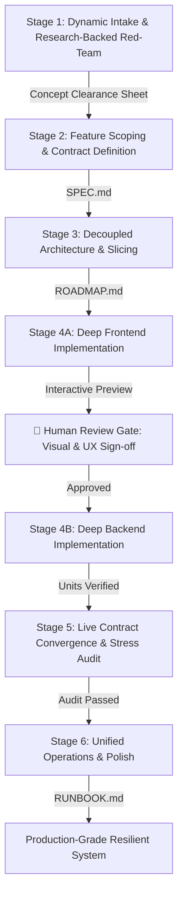

# Agentic Workflow V2: The 6-Stage Master Protocol

This skill guides the agent and user through a high-craftsmanship, 6-stage software development lifecycle engineered to prevent token waste, rushed hallucinations, scope creep, and operational abandonment.

---

## The 6-Stage V2 Lifecycle

---

## Airlocked Stage Gates & Deliverables

Progress across stages is strictly sequential. An agent may NEVER draft downstream artifacts before the active stage is signed off:

1. **Stage 1 Gate:** Signed-off `Concept Clearance Sheet` (Verdict: GREEN or YELLOW with viable pivot blueprints).
2. **Stage 2 Gate:** Locked `SPEC.md` with the "Rule of One" v1 Moat, Out-of-Scope blacklist, and entity contracts.
3. **Stage 3 Gate:** Approved `ROADMAP.md` featuring Phase 0 Contract Lock, Track A (Frontend), and Track B (Backend).
4. **Stage 4 Gate:** 
   - Phase 4A Frontend passes Tier 1 checks and **Human Review Gate sign-off**.
   - Phase 4B Backend passes Tier 1 unit verification against the locked contract.
5. **Stage 5 Gate:** Full-Stack Reality Gate passes 4-Vector Stress Matrix (`Integration Audit Log`).
6. **Stage 6 Gate:** Unified startup script, `kill-dev` multi-port cleaner, `/health` ping, and plain-English `RUNBOOK.md`.

---

## Detailed Stage Reference Guides

When executing any stage, consult its dedicated guide in `references/`:

- [Stage 1: Dynamic Intake & Research-Backed Red-Team](./references/stage-1-intake.md)  
  *Dynamic Delta calibration, open + scaffolded Q&A, Research Rule 4-confidence standards, 18-month freshness, and Yellow/Red pivot blueprints.*
- [Stage 2: Feature Scoping & Contract Definition](./references/stage-2-scoping.md)  
  *The "Rule of One" v1 Moat, 3-bucket triage, empirical schema research, Scope Creep Shield, and `SPEC.md` schema.*
- [Stage 3: Decoupled Architecture & Task Slicing](./references/stage-3-architecture.md)  
  *Phase 0 Contract & Mock Fixture lock, Track A (Frontend) & Track B (Backend) architecture, 4 Slicing Laws, and `ROADMAP.md` schema.*
- [Stage 4: Decoupled Build Loop & Human Review Gate](./references/stage-4-build-loop.md)  
  *Frontend mock build, mandatory Human Review Gate for UI/UX, Backend build, Protocol Beta (2-Strike Circuit Breaker), and Protocol Epsilon (Dependencies).*
- [Stage 5: Live Contract Convergence & Stress Audit](./references/stage-5-integration.md)  
  *The Adapter Flip (mock to live backend), Zero-Mock Reality Gate, and decoupled 4-Vector Stress Matrix.*
- [Stage 6: Unified Operations, Runbook & Polish](./references/stage-6-operations.md)  
  *Unified runner, multi-port killer (`kill-dev`), `/health` ping, graceful shutdown, and `RUNBOOK.md`.*

---

## Core Execution Laws for the Agent

1. **The Anti-Rushing Rule:** Never attempt to solve multiple stages in a single turn. Help the user clarify the idea thoroughly in Stage 1 before ever proposing files or folders.
2. **Research Rigor:** Apply the 4 Confidence Standards. Ground data schemas in primary documentation. Never hallucinate package names or APIs.
3. **Decoupled Discipline:** Always define API payloads and mock adapters before building the frontend. Always let the human test and sign off on the visual UI before building the backend.
4. **Git Hygiene & Circuit Breaker:** Commit atomically on green tasks. Engage Protocol Beta on Strike 2: `git restore .`, pause, and diagnose assumptions with the user.
