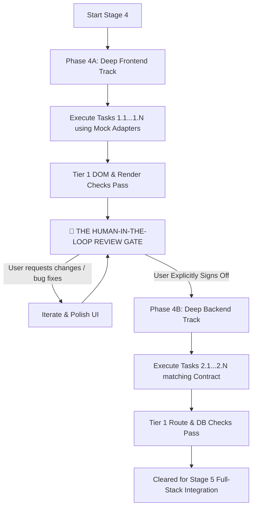

# Stage 4: Decoupled Build Loop & The Human Review Gate

> **Primary Mission:** Author production-grade code with circuit-breaker protection, decoupling frontend and backend with a mandatory human visual review gate.  
> **Mandatory Handoff Artifact:** Verified Atomic Git Commits passing Tier 1 checks.  
> **Exit Gate:** Frontend signed off by human in browser; Backend passes all contract-matching unit checks.

---

## 1. The Decoupled Execution Flow

Stage 4 strictly splits implementation into two sequential phases separated by a human visual approval gate:



---

## 2. Phase 4A: Deep Frontend Track (Mock-Driven)

1. **Build Against the Mock Adapter:** 
   - All UI components query `src/client/api/mock-adapter.js` or local fixture data.
   - Zero dependence on a live database or backend server at this stage.
2. **Visual & Behavioral Craftsmanship:**
   - Implement vibrant, modern design tokens, smooth micro-interactions, responsive containers, and clear empty/loading/error states.
   - Do not use lazy placeholders; write realistic mock copy.
3. **Task-Boundary Verification:**
   - Execute the Tier 1 pass/fail command defined in `ROADMAP.md` for each slice.
   - Commit atomically when green.

---

## 3. 🛑 The Human-in-the-Loop Review Gate (MANDATORY)

Once all Frontend tasks are complete, the agent **MUST PAUSE** before writing any backend code:

1. **Boot Local Dev Preview:** Start the frontend server and provide the clickable local URL (e.g. `http://localhost:5173` or open `index.html`).
2. **Present the Review Checklist to the User:**
   - Visual aesthetics, typography, and color harmony.
   - Interaction feel (button clicks, modal transitions, form inputs).
   - Empty states (when 0 records exist) and loading skeletons.
   - Responsive layout across screen widths.
3. **Iterative Polish:**
   - If the user notices awkward padding, confusing button placement, or missing inputs, address them immediately.
   - Changing the frontend now takes minutes and costs zero database migration rework.
4. **Sign-Off Requirement:** The agent may only proceed to Phase 4B when the user explicitly confirms (e.g., *"UI looks great, proceed to backend"*).

---

## 4. Phase 4B: Deep Backend Track (Contract-Matching)

1. **Build Against Locked Contracts:**
   - Implement database schemas, controllers, and business logic to satisfy the exact endpoints and payloads defined in Phase 0.
   - Never alter payload key names without an explicit reason and contract update.
2. **Tier 1 Unit Verification:**
   - Run isolated unit checks on database queries and route handlers.
   - Ensure routes return HTTP 200/201 with correctly shaped JSON.

---

## 5. Protocol Epsilon: Autonomous Dependency Validation

Never blindly install packages from model memory:
- Run a 1-second background registry verification before installing any package:
  ```bash
  npm view <package-name> version
  # or: pip index versions <package-name>
  ```
- Reject unmaintained packages (>18 months dormant) or micro-packages that pull heavy transitive dependencies.
- **The Native Standard:** Prioritize native platform capabilities (`fetch()`, `crypto.randomUUID()`, `Intl`) over external npm packages.

---

## 6. Protocol Beta: The 2-Strike Circuit Breaker

When an atomic task fails its Tier 1 verification check:

```text
[Task Fails Binary Verification]
             │
             ▼
 Strike 1: Analyze error trace. Apply ONE targeted surgical fix within assigned files. Re-run verification.
             │
        Fails Again?
             │
             ▼
 Strike 2: CIRCUIT BREAKER ENGAGED.
           1. HALT all code generation immediately.
           2. Execute: git restore . (revert to last green commit).
           3. Formulate root-cause diagnosis.
           4. Present the failed underlying assumption to the user.
```

**The Circuit Breaker Rule:** Never attempt a speculative 3rd fix on dirty working trees. Revert first, re-evaluate assumptions with the human, then re-attack cleanly.

---

## 7. Atomic Git Commit Discipline

Commit after every verified task slice with semantic tagging:
```bash
git add src/client/components/Feed.js src/client/styles/index.css
git commit -m "feat(ui): implement activity feed component with mock adapter (Task 1.2)"
```
