# 6-Stage Agentic Pipeline Protocol

This skill guides the agent and user through a battle-tested, 6-stage software development lifecycle designed specifically to prevent token-waste loops, hallucinated architecture, scope creep, and post-build abandonment.

---

## The 6-Stage Lifecycle at a Glance

```mermaid
graph LR
    S1[Stage 1: Intake & Red-Team] -->|Clearance Sheet| S2[Stage 2: Feature Scoping]
    S2 -->|SPEC.md| S3[Stage 3: Architecture & Slicing]
    S3 -->|ROADMAP.md| S4[Stage 4: Atomic Build Loop]
    S4 -->|Unit Verified| S5[Stage 5: Full-Stack Integration]
    S5 -->|Audit Passed| S6[Stage 6: Polish & Runbook]
    S6 -->|RUNBOOK.md| Ship[Production-Ready System]
```

### Airlocked Handoff Rule
Never jump ahead. Each stage produces a concrete, repo-anchored artifact that acts as the entry ticket to the next stage:

1. **Stage 1 -> Stage 2 Gate:** Signed-off `Concept Clearance Sheet` (Verdict: GREEN or YELLOW).
2. **Stage 2 -> Stage 3 Gate:** Locked `SPEC.md` with explicit Out-of-Scope blacklist.
3. **Stage 3 -> Stage 4 Gate:** Approved `ROADMAP.md` sliced into $\le 30$-minute atomic tasks ($\le 3$ files).
4. **Stage 4 -> Stage 5 Gate:** All individual tasks pass Tier 1 single-file unit verification.
5. **Stage 5 -> Stage 6 Gate:** Zero-Mock Reality Gate & 4-Vector Stress Matrix pass (`Integration Audit Log`).
6. **Stage 6 -> Complete Gate:** Plain-English `RUNBOOK.md`, `kill-dev` script, and `/health` route active.

---

## Detailed Stage Reference Guides

When executing a specific stage, view its dedicated reference guide in `references/` for full schemas, question rubrics, and failure modes:

- [Stage 1: Socratic Interrogation & Red-Teaming](./references/stage-1-intake.md)
  *Dynamic Delta 4-pillar diagnosis, multiple-choice scaffolding, empirical anti-hallucination checks, Concept Clearance Sheet schema.*
- [Stage 2: Feature Scoping & The v1 Moat](./references/stage-2-scoping.md)
  *The "Rule of One" core loop, 3-bucket feature triage, Scope Creep Shield pushback protocol, `SPEC.md` schema.*
- [Stage 3: System Architecture & Task Slicing](./references/stage-3-architecture.md)
  *3 archetype directory blueprints, scaffolding pre-flight checklist, the 4 Slicing Laws ($\le 3$ files), `ROADMAP.md` schema.*
- [Stage 4: Atomic Build Loop & Circuit Breakers](./references/stage-4-build-loop.md)
  *Protocol Epsilon (autonomous dependency validation), Protocol Beta (2-Strike Circuit Breaker with Git rollback), Git commit hygiene.*
- [Stage 5: Full-Stack Integration & Stress Audit](./references/stage-5-integration.md)
  *Zero-Mock Reality Gate, 4-Vector Stress Matrix (Cold Boot, Empty State, Network Chaos/429, Port Cleanup), Integration Audit Log.*
- [Stage 6: Polish, Deployment & Operational Lifelines](./references/stage-6-operations.md)
  *Protocol Delta, "Vibe-Coder Survival Runbook" (`RUNBOOK.md`), `kill-dev` zombie killer, Archetype Deployment Matrix, `/health` ping.*

---

## Execution Directives for the Agent

1. **Always Scaffold Choices:** When asking diagnostic questions in Stage 1 or resolving technical trade-offs in Stage 3, provide structured options (Option A vs. Option B) with a sensible default recommendation. Never force the user to architect solutions from scratch.
2. **Surgical Non-Destructive Edits:** When building in Stage 4, modify only files explicitly assigned to the active atomic task. Never re-write entire files when targeted surgical replacements suffice.
3. **Strict Git Discipline:** Commit after every atomic task. If Strike 2 is reached on any bug, execute `git restore` immediately rather than compounding errors.
4. **Living State Persistence:** Maintain progress in `ROADMAP.md` and `Plan.md` so work can be paused, compacted, or resumed at any time with zero context loss.
