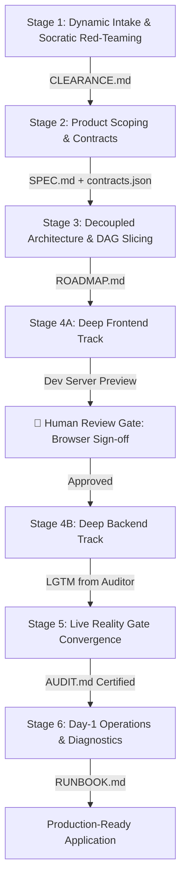

# Deep Agentic Pipeline Plugin

> **Enterprise-Grade Multi-Agent Software Engineering Engine**  
> *Deterministic State Machine • Airlocked Quality Gates • Decoupled Execution • Zero-Mock Reality Gate • Day-1 SRE Runbooks*

---

## Overview

The **Deep Agentic Pipeline** is an enterprise-grade Google Antigravity plugin engineered to transform rough or ambiguous user ideas into reliable, verified, production-grade applications. It solves the critical failure modes of conventional agentic coding: premature rushing, superficial QA, tangled full-stack bugs, hallucinated dependencies, and operational abandonment.

### The 6-Stage Deterministic Lifecycle



---

## 10 World-Class Personas

Every stage and review gate is governed by specialized subagents anchored to industry-standard engineering philosophies:

1. **`strategy-inquisitor`** (Stage 1): Principal Strategic Partner & Socratic Red-Teamer (Amazon PR/FAQ, Kahneman Pre-Mortem).
2. **`moat-guardian`** (Stage 2): Principal Product Architect (Ryan Singer *Shape Up* "Rule of One", Marty Cagan *Inspired*).
3. **`contract-modeler`** (Stage 2/3): Lead Systems Contract Modeler (OpenAPI 3.1, Stripe API Guidelines, Eric Evans DDD).
4. **`systems-architect`** (Stage 3): Principal Enterprise Architect (Clean Architecture, Ports & Adapters, 12-Factor App).
5. **`dag-slicer`** (Stage 3): DAG Task Slicing Specialist ($\le 3$ files, $\le 30$ mins, binary test contracts).
6. **`frontend-craft-specialist`** (Stage 4A): Staff UI/UX Craft Engineer (*Refactoring UI*, Nielsen Norman Heuristics, WCAG 2.1 AA).
7. **`backend-systems-specialist`** (Stage 4B): Senior Distributed Systems Engineer (Martin Kleppmann DDIA, ACID, OWASP Top 10).
8. **`code-auditor`** (Stage 4 Review): Staff Quality & Anti-Pattern Inspector (Google Engineering Practices, AP-001 – AP-008).
9. **`chaos-qa-auditor`** (Stage 5): Chaos Engineer & Quality Architect (Netflix Chaos Engineering, Zero-Mock Philosophy).
10. **`sre-specialist`** (Stage 6): Principal DevOps & Site Reliability Engineer (Google SRE Book, Operational Telemetry).

---

## Core Operational Laws

1. **Law of Sequential Airlocks:** Never draft downstream artifacts before upstream exit gates are committed and verified.
2. **Law of Zero Self-Review:** Every plan, schema, and code slice requires independent audit and an objective `LGTM`.
3. **Protocol Beta (2-Strike Circuit Breaker):** Two failed verification attempts trigger `git restore .` and root-cause diagnosis.
4. **The Anti-Pattern Defense System (AP-001 – AP-008):** Zero mock leakage, zero compiler appeasement, zero mass staging (`git add .`), zero unbounded sprawl, zero secret baking.
5. **🛑 The Human-in-the-Loop Review Gate:** Frontend is built against mock adapters and reviewed live in the browser before backend implementation begins.
6. **Protocol Delta (Operational Survival):** Projects ship with `npm run doctor`, cross-platform `kill-dev` port cleaner, and plain-English `RUNBOOK.md`.

---

## Installation

### Workspace Installation (Current Workspace)
Copy `deep-agentic-pipeline/` into `.agents/plugins/`:
```bash
mkdir -p .agents/plugins
cp -r deep-agentic-pipeline .agents/plugins/
```

### Global Installation (All Projects)
Copy `deep-agentic-pipeline/` into `~/.gemini/config/plugins/`:
```bash
cp -r deep-agentic-pipeline ~/.gemini/config/plugins/
```
