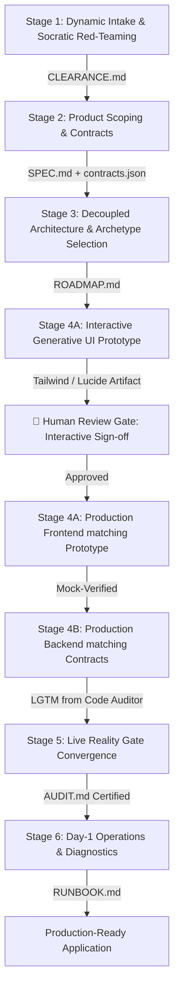

# Deep Agentic Pipeline Plugin

<div align="center">

**Enterprise-Grade Multi-Agent Software Engineering Engine**  
*Deterministic State Machine • Socratic Intake • Decoupled Architecture • Generative UI Prototypes • Zero-Mock Reality Gate • Day-1 SRE Runbooks*

</div>

---

## Overview

The **Deep Agentic Pipeline** (v2.1.0) is an enterprise-grade Google Antigravity plugin engineered to transform rough or ambitious user ideas into reliable, verified, production-grade applications. It solves the critical failure modes of conventional agentic coding: premature rushing, superficial QA, tangled full-stack bugs, hallucinated dependencies, operational abandonment, and amateur "AI UI slop".

### The 6-Stage Deterministic Lifecycle



---

## ⚡ Three Operating Modes

| Mode | Trigger Keyword | Profile | Best For |
| :--- | :--- | :--- | :--- |
| **Standard Mode** | *(default)* | Full 6-stage lifecycle with multi-agent consensus and complete verification. | Greenfield applications, major architectural pivots, complex features |
| **Fast Mode** | `/fast mode` | Single-task surgical patch ($\le 3$ files, $\le 150$ LOC). Bypasses Stages 1–3 if contracts are unchanged; single reviewer. | Tight bug fixes, isolated utility functions |
| **Trivial Mode** | `/trivial mode` | Documentation, comments, and config updates only. Skips audits, tests, and runbooks. | Readmes, comments, chores, typo fixes |

---

## 🎨 The High-Craft Frontend Design System (Anti-Slop Engine)

To eliminate "AI slop" and amateur styling, the plugin enforces strict design constraints:
1. **Interactive HTML/Tailwind Prototype First:** Before multi-file production components are generated, an interactive, single-file HTML artifact is rendered in Antigravity chat using **Tailwind CSS CDN** and **Lucide Icons**. The operator reviews, clicks, and approves the visual direction with zero refactoring cost.
2. **1:1 Framework Translation:** The approved prototype's Tailwind utility classes translate directly into **Next.js 15+ App Router** Server Components (`src/app/page.tsx`), Client Components (`src/components/ui/`), and layouts.
3. **3-Layer Surface Depth:** Mandates Layer 0 (Canvas: `bg-zinc-950`), Layer 1 (Cards: `bg-zinc-900/80` with `border-zinc-800/60`), and Layer 2 (Elevated: `bg-zinc-800`). Flat single-color backgrounds are banned.
4. **Typography Formula:** Headings must declare `tracking-tight` (`letter-spacing: -0.025em`) with $14\text{px}$ body text and $1.5$–$1.6$ line-height.
5. **Zero Emoji UI (AP-009):** Emojis (📁, 📊, 🚀) are strictly banned as UI icons. Every icon must be a clean Lucide SVG icon.

---

## 🏗️ Supported Project Archetypes

- **Archetype 1 (Flagship): Next.js 15+ App Router** (React 19, TypeScript, Tailwind CSS, Lucide React, Server Actions).
- **Archetype 2: Decoupled Vite SPA + Modular API** (Vite client in `src/client/`, Express/Hono in `src/server/`).
- **Archetype 3: Headless API, Python AI / CLI Service** (Explicitly bypasses Track A and the Human Visual Gate; routes directly to domain integration).

---

## 👥 10 World-Class Subagents (`agents/*.md`)

Every stage is governed by specialized subagents registered natively in Antigravity:
1. **`strategy-inquisitor`** (Stage 1): Socratic Red-Teamer & Pre-Mortem Strategist (Amazon PR/FAQ, Kahneman Pre-Mortem AVI scoring).
2. **`moat-guardian`** (Stage 2): Basecamp *Shape Up* "Rule of One" Product Architect (Marty Cagan *Inspired*).
3. **`contract-modeler`** (Stage 2/3): OpenAPI 3.1 & JSON Schema Modeler (Stripe & GitHub API standards).
4. **`systems-architect`** (Stage 3): Enterprise Clean Architect & Next.js App Router specialist.
5. **`dag-slicer`** (Stage 3): Atomic Task Slicing Specialist ($\le 3$ files, $\le 30$ mins, binary test contracts).
6. **`frontend-craft-specialist`** (Stage 4A): Staff UI/UX Craft Engineer (*Refactoring UI*, WCAG 2.2 AA, Next.js).
7. **`backend-systems-specialist`** (Stage 4B): Senior Distributed Systems Engineer (ACID, OWASP Security Shield).
8. **`code-auditor`** (Stage 4 Review): Staff Quality & Anti-Pattern Inspector (AP-001 through AP-009).
9. **`chaos-qa-auditor`** (Stage 5): Chaos Engineer & Quality Architect (Netflix Chaos Engineering, Zero-Mock Philosophy).
10. **`sre-specialist`** (Stage 6): Site Reliability Engineer (`npm run doctor`, `kill-dev`, Day-1 Runbooks).

---

## 🛡️ Anti-Pattern Defense System (AP-001 – AP-009)

- **AP-001:** Zero Mock Leakage (mocks quarantined from production backend paths).
- **AP-002:** Zero Compiler Appeasement (`@ts-ignore`, `any`, blanket `catch {}` strictly banned).
- **AP-003:** Zero Blind Mass Staging (`git add .` and `git commit -a` blocked by pre-tool hooks).
- **AP-004:** Zero Multi-File Thrashing ($\le 3$ files per slice).
- **AP-005:** Zero Unhandled Async (mandatory localized `try/catch` boundaries).
- **AP-006:** Zero Unbounded Sprawl (mandatory query `LIMIT` bounds and listener cleanup).
- **AP-007:** Zero Secret Baking (all credentials loaded via `.env`).
- **AP-008:** Zero Narrative Comments (delete conversational commentary).
- **AP-009:** Zero AI UI Slop (no emoji icons, mandatory 3-layer surface depth, strict typography).

---

## 🚀 Installation & Activation

### Workspace Installation (Current Workspace)
Copy `deep-agentic-pipeline/` into `.agents/plugins/`:
```bash
mkdir -p .agents/plugins
cp -r deep-agentic-pipeline .agents/plugins/
```

### Global Installation (All Workspaces)
Copy `deep-agentic-pipeline/` into `~/.gemini/config/plugins/`:
```bash
cp -r deep-agentic-pipeline ~/.gemini/config/plugins/
```
