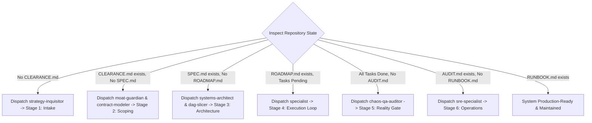

# Deep Agentic Pipeline: The 6-Stage Master Orchestrator

This skill coordinates a deterministic, hub-and-spoke multi-agent state machine designed to engineer production-grade software while completely eliminating rushed hallucinations, scope creep, tangled full-stack thrashing, and operational abandonment.

---

## 1. Operating Modes

The pipeline adapts to task scale across three operating modes:

| Mode | Trigger Keyword | Profile | Best For |
| :--- | :--- | :--- | :--- |
| **Standard Mode** | *(default)* | Full 6-stage lifecycle with multi-agent consensus and complete verification. | New applications, major refactors, complex system features |
| **Fast Mode** | `/fast mode` | Surgical single-task execution ($\le 3$ files, $\le 150$ LOC). Bypasses Stages 1–3 if contracts are unchanged; single `code-auditor` review. | Bug fixes, tight patches, isolated function additions |
| **Trivial Mode** | `/trivial mode` | Documentation, comments, and config updates only. Skips audits, tests, and runbooks. | Readmes, comments, chores, typo fixes |

---

## 2. Active State Dispatcher

The Master Orchestrator inspects the repository state to determine the active stage and dispatch the appropriate specialist persona:



### Stage Dispatch Table

| Repository State | Active Stage | Assigned Lead Persona | Reference Guide | Required Exit Deliverable |
| :--- | :---: | :--- | :--- | :--- |
| No `CLEARANCE.md` | **Stage 1** | `strategy-inquisitor` | [Stage 1 Intake](./references/stage-1-intake.md) | `CLEARANCE.md` (Signed) |
| `CLEARANCE.md` present, no `SPEC.md` | **Stage 2** | `moat-guardian` & `contract-modeler` | [Stage 2 Scoping](./references/stage-2-scoping.md) | `SPEC.md` & `contracts.json` |
| `SPEC.md` present, no `ROADMAP.md` | **Stage 3** | `systems-architect` & `dag-slicer` | [Stage 3 Architecture](./references/stage-3-architecture.md) | `ROADMAP.md` (Approved Archetype) |
| `ROADMAP.md` with pending tasks | **Stage 4** | `frontend-craft-specialist` / `backend-systems-specialist` | [Stage 4 Build Loop](./references/stage-4-build-loop.md) | All tasks green + Human Gate sign-off |
| All tasks checked, no `AUDIT.md` | **Stage 5** | `chaos-qa-auditor` | [Stage 5 Reality Gate](./references/stage-5-integration.md) | `AUDIT.md` (6/6 vectors pass) |
| `AUDIT.md` present, no `RUNBOOK.md` | **Stage 6** | `sre-specialist` | [Stage 6 Operations](./references/stage-6-operations.md) | `RUNBOOK.md` + passing `npm run doctor` |

---

## 3. Global Execution Invariants

1. **Law of Sequential Airlocks:** Never draft downstream artifacts before upstream gates are approved and committed.
2. **Law of Zero Self-Review:** Every plan, schema, and code slice requires an independent audit and an objective `LGTM` from `code-auditor`.
3. **Protocol Beta (2-Strike Circuit Breaker):** Two consecutive task failures trigger an immediate `git restore .` and root-cause diagnosis.
4. **Surgical Staging (AP-003):** Bulk staging (`git add .`) and bypass commit flags (`git commit -a`) are strictly blocked. Stage only slice-assigned files explicitly.
5. **🛑 Human Review Gate & Interactive Generative UI Prototype:** For UI projects (Archetypes 1 & 2), the frontend is prototyped as an interactive HTML/Tailwind artifact and reviewed live before multi-file production components or backend code are written.
6. **High-Craft Design Standard (AP-009):** Emojis as UI icons are strictly prohibited; 3-layer surface depth, tight heading typography (`tracking-tight`), and 4 visual component states are mandatory.

---

## 4. Subagent Persona Directory

All 10 specialist subagents are registered natively in `agents/` and callable via `invoke_subagent`:
- **Stage 1:** [`strategy-inquisitor`](../../agents/strategy-inquisitor.md) — Socratic Red-Teamer & Pre-Mortem Strategist.
- **Stage 2:** [`moat-guardian`](../../agents/moat-guardian.md) — Basecamp Shape Up "Rule of One" Product Architect.
- **Stage 2/3:** [`contract-modeler`](../../agents/contract-modeler.md) — OpenAPI/JSON Schema & Mock Fixture Modeler.
- **Stage 3:** [`systems-architect`](../../agents/systems-architect.md) — Next.js 15+ App Router & Clean Enterprise Architect.
- **Stage 3:** [`dag-slicer`](../../agents/dag-slicer.md) — Atomic Task Slicing Specialist ($\le 3$ files, $\le 30$ mins, binary test contracts).
- **Stage 4A:** [`frontend-craft-specialist`](../../agents/frontend-craft-specialist.md) — Staff UI/UX Craft Engineer (Zero AI Slop, Tailwind, Lucide React).
- **Stage 4B:** [`backend-systems-specialist`](../../agents/backend-systems-specialist.md) — Senior Distributed Systems Engineer (ACID, OWASP Security Shield).
- **Stage 4 Review:** [`code-auditor`](../../agents/code-auditor.md) — Staff Quality & Anti-Pattern Inspector (AP-001 through AP-009).
- **Stage 5:** [`chaos-qa-auditor`](../../agents/chaos-qa-auditor.md) — Zero-Mock Chaos Engineer (6-Vector Stress Matrix).
- **Stage 6:** [`sre-specialist`](../../agents/sre-specialist.md) — Site Reliability Engineer (`kill-dev`, `doctor.js`, Day-1 Runbooks).

---

## 5. Copyable Workflow Invocation Template

```markdown
# INVOKE: deep-agentic-pipeline (v2.1.0)

## 1. Operating Mode (Select one)
- [x] **Standard Mode** — Full 6-stage lifecycle (Default)
- [ ] **/fast mode** — Single-task patch (<= 3 files, 1 reviewer)
- [ ] **/trivial mode** — Docs, chores, or comments only

## 2. Project Archetype
- [x] **Archetype 1:** Next.js 15+ App Router (Full-Stack React 19 + TypeScript + Tailwind)
- [ ] **Archetype 2:** Decoupled Vite SPA + Express/Hono
- [ ] **Archetype 3:** Headless API / CLI / Python AI Service (Bypasses UI tracks)

## 3. Task Brief
[INSERT TASK / FEATURE DESCRIPTION HERE]
```
