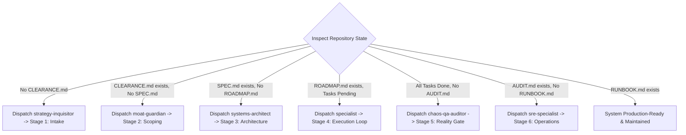

# Deep Agentic Pipeline: The 6-Stage Master Orchestrator

This skill coordinates a deterministic, hub-and-spoke multi-agent state machine designed to engineer production-grade software while completely eliminating rushed hallucinations, scope creep, tangled full-stack thrashing, and operational abandonment.

---

## 1. Active State Dispatcher

The Master Orchestrator inspects the repository state to determine the active stage and dispatch the appropriate specialist persona:

### Stage Dispatch Table

| Repository State | Active Stage | Assigned Lead Persona | Reference Guide | Required Exit Deliverable |
| :--- | :---: | :--- | :--- | :--- |
| No `CLEARANCE.md` | **Stage 1** | `strategy-inquisitor` | [Stage 1 Intake](./references/stage-1-intake.md) | `CLEARANCE.md` (Signed) |
| `CLEARANCE.md` present, no `SPEC.md` | **Stage 2** | `moat-guardian` & `contract-modeler` | [Stage 2 Scoping](./references/stage-2-scoping.md) | `SPEC.md` & `contracts.json` |
| `SPEC.md` present, no `ROADMAP.md` | **Stage 3** | `systems-architect` & `dag-slicer` | [Stage 3 Architecture](./references/stage-3-architecture.md) | `ROADMAP.md` (Approved) |
| `ROADMAP.md` with pending tasks | **Stage 4** | `frontend-craft-specialist` / `backend-systems-specialist` | [Stage 4 Build Loop](./references/stage-4-build-loop.md) | All tasks green + Human Gate sign-off |
| All tasks checked, no `AUDIT.md` | **Stage 5** | `chaos-qa-auditor` | [Stage 5 Reality Gate](./references/stage-5-integration.md) | `AUDIT.md` (6/6 vectors pass) |
| `AUDIT.md` present, no `RUNBOOK.md` | **Stage 6** | `sre-specialist` | [Stage 6 Operations](./references/stage-6-operations.md) | `RUNBOOK.md` + passing `npm run doctor` |

---

## 2. Global Execution Invariants

1. **Law of Sequential Airlocks:** Never draft downstream artifacts before upstream gates are approved and committed.
2. **Law of Zero Self-Review:** Every plan, schema, and code slice requires an independent audit and an objective `LGTM`.
3. **Protocol Beta (2-Strike Circuit Breaker):** Two consecutive task failures trigger an immediate `git restore .` and root-cause diagnosis.
4. **Surgical Staging (AP-003):** Bulk staging (`git add .`) is strictly blocked. Stage only slice-assigned files.
5. **🛑 Human Review Gate:** Frontend is built against mock adapters and reviewed live in the browser before backend construction begins.

---

## 3. Session Isolation Architecture (`.pipeline/session-[ID]/`)

To preserve clean repository root hygiene:
- On pipeline kickoff, create an isolated directory: `.pipeline/session-[SHA]/`.
- **Working State Files:**
  - `state.json`: Active stage pointer, locked constraints, completed slices.
  - `reviews/`: Subagent audit logs, reviewer critique notes, and `LGTM` stamps.
  - `contracts/`: Raw JSON schema drafts and mock fixtures.
- **Root Facade:** Only vetted master deliverables reside in root (`CLEARANCE.md`, `SPEC.md`, `ROADMAP.md`, `AUDIT.md`, `RUNBOOK.md`).

---

## 4. Subagent Persona Directory

When adopting a subagent persona, review its core philosophy and checklist in `personas/`:
- [01: Strategy Inquisitor](./personas/01-strategy-inquisitor.md)
- [02: Moat Guardian](./personas/02-moat-guardian.md)
- [03: Contract Modeler](./personas/03-contract-modeler.md)
- [04: Systems Architect](./personas/04-systems-architect.md)
- [05: DAG Slicer](./personas/05-dag-slicer.md)
- [06: Frontend Craft Specialist](./personas/06-frontend-craft-specialist.md)
- [07: Backend Systems Specialist](./personas/07-backend-systems-specialist.md)
- [08: Adversarial Code Auditor](./personas/08-adversarial-code-auditor.md)
- [09: Chaos QA Auditor](./personas/09-chaos-qa-auditor.md)
- [10: SRE Specialist](./personas/10-sre-specialist.md)
