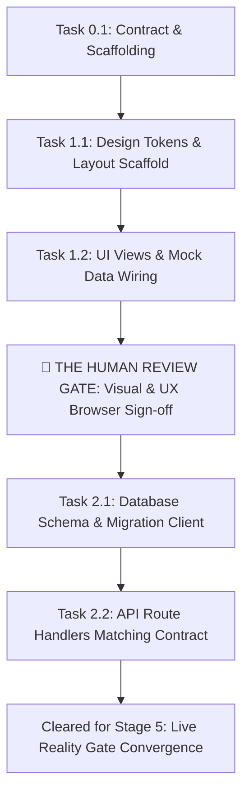

# [Project Name] — Execution Roadmap (`ROADMAP.md`)

> **Session ID:** [6-char SHA] | **Date:** [YYYY-MM-DD]  
> **Status:** APPROVED & ACTIVE | **Selected Archetype:** Archetype B (Decoupled Full-Stack)  
> **Lead Architect:** Subagent `systems-architect` | **DAG Slicer:** Subagent `dag-slicer`

---

## 1. Visual Dependency DAG (Directed Acyclic Graph)

---

## 2. Phase 0: Contract Scaffolding & Pre-Flight

### Task 0.1: Directory Tree & Mock Fixtures Scaffolding
- **Files Touched (Max 3):** `package.json`, `.gitignore`, `src/shared/contracts.json`
- **Depends On:** None
- **Pre-Flight Test Contract:**
  - *Command:* `node -e "assert(require('./src/shared/contracts.json').endpoints.length > 0)"`
  - *Expected Result:* Exits with code 0.
- **Status:** [ ] Pending

---

## 3. Phase 1: Track A — Frontend Implementation (Mock-Driven)

### Task 1.1: Design Tokens & Core Layout Scaffolding
- **Files Touched (Max 3):** `src/client/index.html`, `src/client/styles/tokens.css`, `src/client/styles/main.css`
- **Action:** Implement extracted design tokens, global reset, and responsive shell container.
- **Depends On:** Task 0.1
- **Pre-Flight Test Contract:**
  - *Command:* Verify file existence and CSS token declarations.
  - *Expected Result:* Zero syntax errors; tokens declare `--color-primary`, `--color-surface`.
- **Status:** [ ] Pending

### Task 1.2: Interactive Components & Mock Adapter Wiring
- **Files Touched (Max 3):** `src/client/components/table.js`, `src/client/api/mock-adapter.js`, `src/client/app.js`
- **Action:** Render input form, action buttons, table view, and wire to mock fixtures.
- **Depends On:** Task 1.1
- **Pre-Flight Test Contract:**
  - *Command:* `node src/client/api/test-mock.js`
  - *Expected Result:* Mock adapter returns mock fixture data matching schema.
  - **Status:** [ ] Pending

---

## 4. 🛑 The Human-in-the-Loop Review Gate (MANDATORY PAUSE)
- **Objective:** The agent starts the local frontend server and provides the clickable local URL.
- **Operator Review:** Test interaction, typography, visual appeal, empty state, and responsive behavior.
- **Sign-Off Condition:** The user must explicitly approve the frontend before any Phase 2 backend code is written.

---

## 5. Phase 2: Track B — Backend Implementation (Contract-Matching)

### Task 2.1: Database Schema & Migration Client
- **Files Touched (Max 3):** `src/server/db/client.js`, `src/server/db/schema.sql`, `package.json`
- **Action:** Initialize SQLite database, execute migrations for locked entities, export client.
- **Depends On:** Human Review Gate Sign-off
- **Pre-Flight Test Contract:**
  - *Command:* `node src/server/db/client.js --test`
  - *Expected Result:* Prints `Database connected and schema initialized` and exits 0.
- **Status:** [ ] Pending

### Task 2.2: Controller Handlers & Route Registration
- **Files Touched (Max 3):** `src/server/app.js`, `src/server/routes/api.js`, `src/server/controllers/items.js`
- **Action:** Mount API routes, query DB client, return JSON payloads satisfying `contracts.json`.
- **Depends On:** Task 2.1
- **Pre-Flight Test Contract:**
  - *Command:* `node src/server/routes/test-routes.js`
  - *Expected Result:* Endpoints return HTTP 200/201 with valid JSON matching contract schema.
- **Status:** [ ] Pending

---

## 6. Official Handoff Gate
- **Verdict:** Approved Execution Roadmap
- **Entry Ticket to Stage 4:** Committed to root `ROADMAP.md`.
